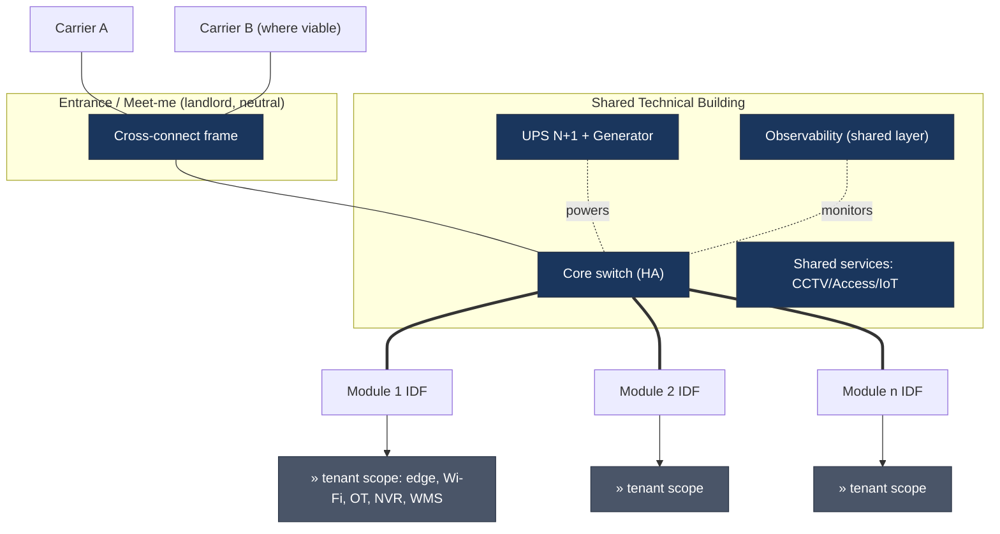
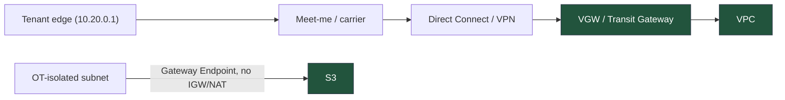

# Topology — shared infrastructure

- Thick `===` = optical backbone (landlord) to each module IDF — the delivery boundary.
- Everything past the IDF (`»`) is tenant scope: specified as interface, not designed
  by the landlord.
- The meet-me is the single neutral convergence point; carrier and tenant WAN are the
  same physical path, not opposite sides.

## Hybrid cloud path (corrected)

DX/VPN terminate on **VGW/TGW, never IGW**; the isolated subnet reaches S3 via a
**Gateway VPC Endpoint** with no internet path.
